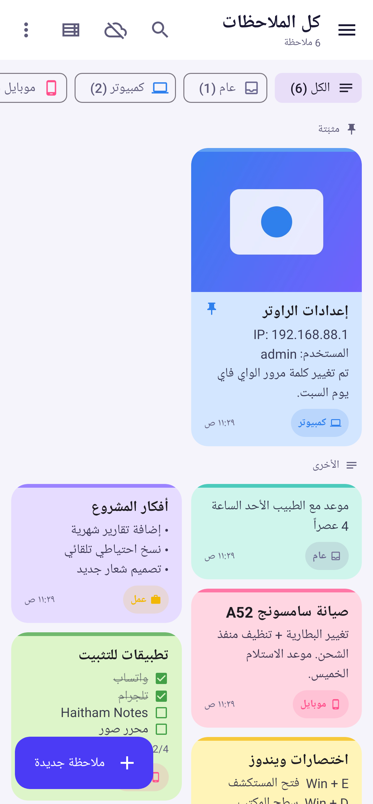
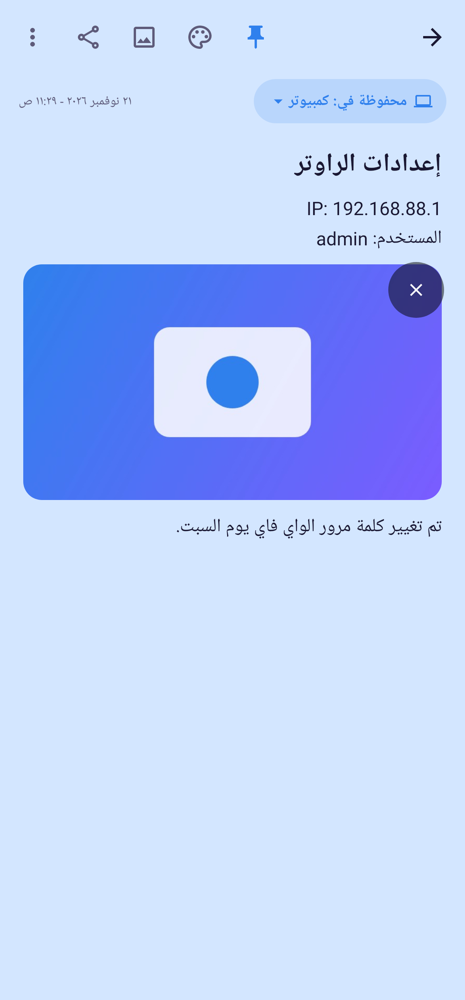
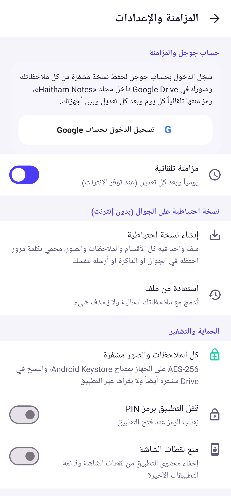
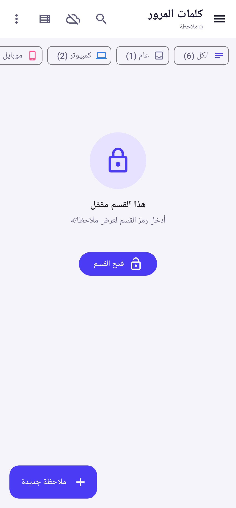

<div dir="rtl">

<p align="center"></p>

# Haitham Notes

تطبيق ملاحظات احترافي لأندرويد بفكرة **ColorNote** مع **أقسام** تنشئها بنفسك (كمبيوتر، موبايل، عمل…) والملاحظات داخل كل قسم، **صور داخل الملاحظة**، **تشفير كامل**، و**مزامنة يومية تلقائية مع Google Drive** بتسجيل الدخول بحساب جوجل.

<p align="center">






</p>

## المميزات

| الميزة | التفاصيل |
|---|---|
| الأقسام | أنشئ أي عدد من الأقسام باسم ولون وأيقونة، رتّبها، عدّلها، احذفها (مع نقل ملاحظاتها إلى «عام» أو للسلة). شريط أقسام في الأعلى وقائمة جانبية بعدد الملاحظات في كل قسم |
| أين تُحفظ؟ | عند إضافة ملاحظة جديدة يسألك التطبيق: **«في أي قسم تريد حفظها؟»**، وداخل الملاحظة يظهر «محفوظة في: …» ويمكن تغييره بضغطة |
| الملاحظات | نص أو قائمة مهام (✓)، 9 ألوان، تثبيت في الأعلى، بحث، ترتيب (آخر تعديل/الإنشاء/العنوان/اللون)، عرض شبكة أو قائمة، حفظ تلقائي أثناء الكتابة |
| الصور | إضافة صور من المعرض أو الكاميرا **داخل الملاحظة نفسها** بين الفقرات، عرضها بملء الشاشة مع التكبير |
| الإرسال | إرسال الملاحظة بنصها وصورها لأي تطبيق (واتساب، تلجرام، بريد…)، ونسخ النص. واستقبال نص/صورة من تطبيقات أخرى كملاحظة جديدة |
| المزامنة | تسجيل الدخول بحساب Google، مزامنة **يومية تلقائية** + بعد كل تعديل + «مزامنة الآن»، داخل مجلد **Haitham Notes** في Google Drive، وتعمل بين عدة أجهزة (الأحدث يفوز) |
| الحماية | تشفير **AES-256-GCM** لكل الملاحظات والصور على الجهاز بمفتاح Android Keystore، النسخ في Drive مشفرة أيضاً، قفل برمز PIN أو بالبصمة، منع لقطات الشاشة |
| قفل قسم معيّن | اجعل أي قسم سرياً برمز خاص به (أو افتحه بالبصمة/رمز التطبيق). ملاحظاته تختفي من «الكل» والبحث والسلة حتى تفتحه، ويُعاد قفله تلقائياً بعد الخروج من التطبيق |
| تصدير PDF | حفظ أو إرسال أي ملاحظة كملف PDF، أو قسم كامل/كل الملاحظات في ملف واحد (نص عربي + صور + اسم المطوّر في التذييل) |
| نسخة على الجوال | ملف نسخة احتياطية واحد `.hnbak` بكل الأقسام والملاحظات والصور، محمي بكلمة مرور، يعمل بدون إنترنت، والاستعادة تدمج مع الموجود |
| سلة المحذوفات | استعادة أو حذف نهائي (يصل الحذف لكل الأجهزة) |
| التحديثات | يفحص التطبيق آخر إصدار في GitHub Releases عند كل تشغيل ويعرض «تحديث جديد متوفر» لكل المستخدمين |
| المظهر | واجهة عربية RTL كاملة، وضع فاتح وداكن وتلقائي، شعار مميز |

---

## الإعداد (مرة واحدة)

### 1) مفتاح التوقيع وأسرار GitHub
يمكنك استخدام **نفس ملف التوقيع** `haitham-release.jks` الخاص بتطبيق Haitham Router Master (أسهل)، أو إنشاء واحد جديد:
```bash
keytool -genkeypair -v -keystore haitham-release.jks -alias haitham -keyalg RSA -keysize 2048 -validity 10000
base64 -w0 haitham-release.jks > KEYSTORE_BASE64.txt
```
ثم من **Settings > Secrets and variables > Actions** في هذا المستودع أضف:

| الاسم | القيمة |
|---|---|
| `KEYSTORE_BASE64` | محتوى `KEYSTORE_BASE64.txt` |
| `KEYSTORE_PASSWORD` | كلمة مرور الملف |
| `KEY_ALIAS` | `haitham` |
| `KEY_PASSWORD` | كلمة مرور المفتاح |

> ⚠️ احتفظ بملف التوقيع وكلمة مروره خارج GitHub. **إذا ضاع لن تستطيع إصدار تحديثات**، وسيتوقف تسجيل الدخول بجوجل في النسخ الجديدة.

### 2) تفعيل تسجيل الدخول بجوجل و Google Drive
1. افتح [Google Cloud Console](https://console.cloud.google.com/) وأنشئ مشروعاً جديداً (مثلاً Haitham Notes).
2. **APIs & Services > Library** ← فعّل **Google Drive API**.
3. **OAuth consent screen** (أو Google Auth Platform > Branding): نوع **External**، اسم التطبيق Haitham Notes، بريدك للدعم. في **Data Access** أضف النطاقين:
   `.../auth/drive.file` و `.../auth/drive.appdata` (نطاقات غير حساسة، لا تحتاج مراجعة من جوجل).
   ثم في **Audience** اضغط **Publish app** ليتمكن أي شخص من تسجيل الدخول (في وضع Testing يعمل فقط للحسابات المضافة كـ Test users).
4. **Credentials > Create credentials > OAuth client ID** ← النوع **Android**:
   - Package name: `com.haitham.notes`
   - SHA-1: من ملف التوقيع:
     ```bash
     keytool -list -v -keystore haitham-release.jks -alias haitham
     ```
5. لا حاجة لوضع أي مفتاح داخل الكود؛ جوجل تتعرف على التطبيق من اسم الحزمة وبصمة التوقيع.

> تسجيل الدخول يعمل فقط في النسخ الموقّعة بالمفتاح الذي أضفت بصمته (SHA-1). النسخ التجريبية بدون مفتاح لن تستطيع تسجيل الدخول.

### 3) التحديثات التلقائية لكل المستخدمين
يجب أن يكون المستودع **عاماً (Public)** ليقرأ التطبيق آخر إصدار (أو غيّر `hn.updateUrl` في `gradle.properties` إلى رابط JSON عام بنفس الصيغة). لنشر تحديث:
```bash
git tag v1.0.1
git push origin v1.0.1
```
يبني GitHub Actions التطبيق ويوقّعه وينشره كـ Release، وتظهر رسالة «تحديث جديد متوفر» لكل المستخدمين عند فتح التطبيق.

---

## كيف تعمل المزامنة والتشفير

```
على الجهاز:   notes.db  ← كل صف JSON مشفّر AES-256-GCM (مفتاح Android Keystore لا يخرج من الجهاز)
              images/*.enc ← الصور مشفرة بنفس الطريقة

Google Drive:  Haitham Notes/notes.hnb     ← كل الأقسام والملاحظات (مضغوطة + مشفرة)
               Haitham Notes/img_<id>.hnb  ← الصور (مشفرة)
               appDataFolder/key.json      ← مفتاح تشفير النسخ (مجلد مخفي لا يصل إليه إلا التطبيق)
```
- صلاحية `drive.file` تعني أن التطبيق **لا يرى إلا الملفات التي أنشأها**، لا يطّلع على بقية ملفاتك في Drive.
- عند تسجيل الدخول من جهاز جديد بنفس الحساب تُستعاد كل الملاحظات والصور تلقائياً.
- الدمج لكل ملاحظة على حدة: التعديل الأحدث يفوز، والحذف النهائي يصل لكل الأجهزة.

## الاسم ورقم التواصل
في `gradle.properties`:
- `hn.developerName`: اسم المطوّر (هيثم العريفي)
- `hn.developerPhone`: الرقم الظاهر في التطبيق (775130005)
- `hn.whatsapp`: رقم واتساب بالصيغة الدولية بدون + (967775130005)
- `hn.driveFolder`: اسم مجلد Google Drive (Haitham Notes)

## البناء والاختبارات
```bash
./gradlew assembleRelease          # يحتاج keystore.properties وملف التوقيع في جذر المشروع
./gradlew testDebugUnitTest --tests "*ModelTest*" --tests "*FeatureTest*"   # البيانات والدمج والنسخ والقفل وPDF
./gradlew recordRoborazziDebug     # توليد لقطات الشاشة في docs/screenshots
```

## البنية التقنية
- Kotlin + Jetpack Compose (Material 3)، أندرويد 7.0 فما فوق.
- `data/` الأقسام والملاحظات وقاعدة البيانات المشفرة والصور.
- `crypto/Crypto.kt` التشفير المحلي (Keystore) وتشفير النسخ السحابية.
- `sync/` تسجيل الدخول (Google Identity Authorization API)، عميل Google Drive REST، الدمج، و WorkManager للمزامنة اليومية.
- `util/Updater.kt` فحص التحديثات من GitHub Releases.

</div>

<p align="center">برمجة وتصميم: <b>هيثم العريفي</b> — 775130005</p>
